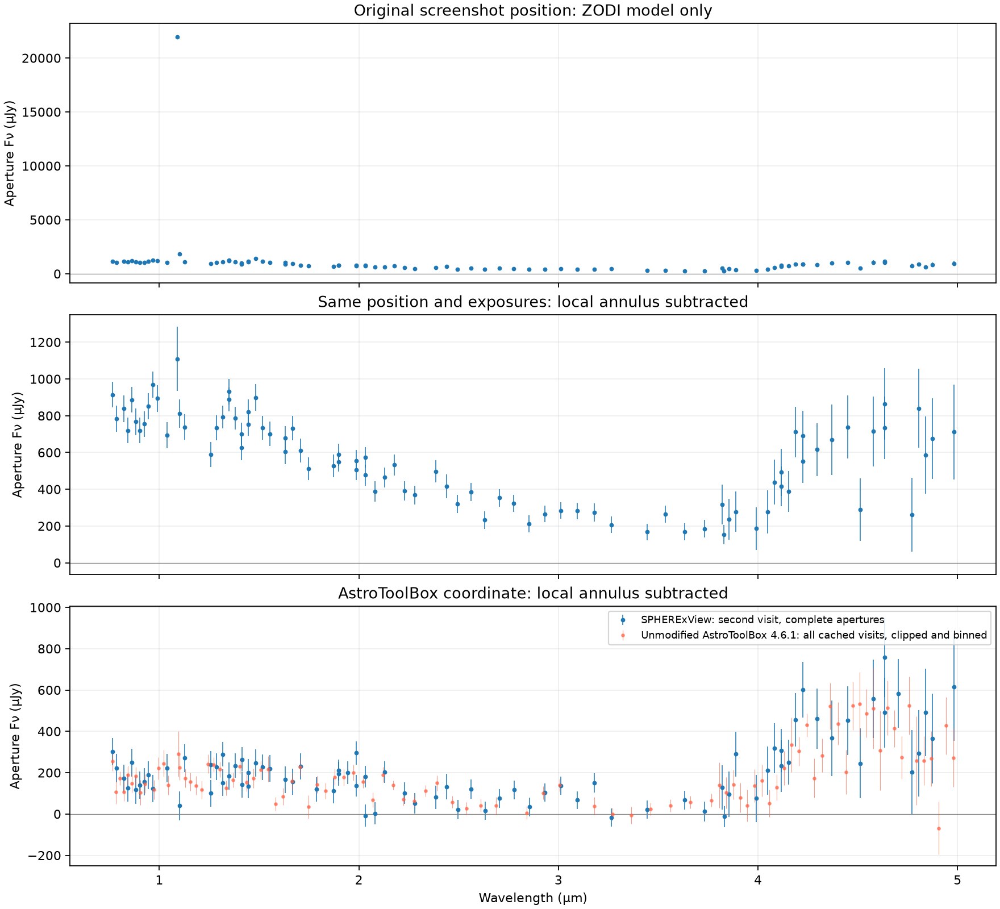

# Spectrum audit: AstroToolBox versus SPHERExView

Audit date: 2026-11-17. Target: ICRS 133.7599588°, −7.2449993°.

## Verdict

**The previous display was not a defensible default source spectrum.** Its
native-pixel aperture arithmetic passes the independent checks below, but
the screenshot combines a different sky position, substantial unsubtracted
local background, and an overshooting display spline. Passing arithmetic
tests did not validate that scientific interpretation. The earlier audit
and UI defaults did not catch this real-data failure.

The corrected local-background-subtracted measurement is a valid *aperture
estimator under stated assumptions*. It is not a validated total-flux,
deblended or aperture-corrected source spectrum. Neither this audit nor a
comparison with AstroToolBox establishes zero error for arbitrary targets.

## Reproduction and evidence

The audit used the running DR1 installation and an older QR2/QR3 checkout.
Both received the display fixes. No backend measurement formula was changed
by this audit.

The screenshot is reproduced from saved result
`a678c919d023428cbc63aa0f94469371`, second epoch, native output pixel (19,20).
Its manifest, exposure identities, calibration URLs and hashes were inspected.
The comparison uses the actual AstroToolBox cached cutouts, not a digitized
screen image or a reimplementation asserted to be equivalent.

The **unmodified AstroToolBox 4.6.1 JAR** was called through a Java adapter:
224 cached files → 222 measured exposures → 200 after its rejection →
94 binned points. The first binned point is
255.7432345 ± 46.3168294 µJy at 0.76402709 µm, matching the screenshot.
Its binned range is −67.97 to 532.70 µJy.

JAR SHA-256:
`96164899c206839bb251cbe559ac0e0877f91b20157fdd66866c4c0b24962076`.

| Controlled comparison | Result |
| --- | --- |
| Screenshot position | 133.7599588°, −7.2432771°: 6.19992″ north of ATB's requested coordinate |
| Original selection | 87 complete measurements out of 128 exposure samples |
| Extreme exposure | D1, `2025W44_2B_0339_1`, 1.0890529 µm |
| ZODI-only aperture sum | 21,975.914 µJy; formal σ ≈147.18 µJy |
| Same pixels with local annulus | 1,109.514 µJy; formal σ ≈175.81 µJy |
| Estimated residual-background contribution | 20,866.401 µJy, **94.951%** of the original sum |
| At the exact ATB coordinate | 84 complete local-sky measurements in that epoch |

The extreme exposure has an approximately 1.8–1.9 MJy/sr background after
ZODI subtraction across nearby pixels. Its clean-annulus coverage is 55.74%,
above the implemented 50% threshold. The empirical background subtraction
explains the numerical reduction; the physical origin of that residual
background was not established by this initial audit. The subsequent
[RGB investigation](rgb-background-2026-11-17/README.md) identifies strong
evidence for atmospheric helium airglow in this exposure, with stated limits.

Position matters independently of background. The selected position is one
6.2″ output pixel north. At the target, the D1–D6 medians after local-sky
subtraction are approximately **172, 223, 155, 67, 290, 491 µJy**. At the
screenshot position they are **839, 745, 526, 265, 427, 714 µJy**. A shifted
aperture in this field measures different source/neighbor contributions.
The images do not establish whether that shift was an intentional click.
It is not evidence of a one-pixel error in our celestial transformation.

At the target coordinate the extreme exposure has 97.966% usable aperture
area, so the complete-aperture selection omits it. Its diagnostic partial
sum is still 20,822.35 µJy before local subtraction and 485.48 µJy after it.
Thus changing position also changes mask selection; simply comparing the
two maxima would conceal that distinction.



The red comparison in the last panel combines ATB's cached visits; the blue
points are our second visit only. This is explicitly not a claim of identical
selection. A separate table matches **222 individual measurements** by
observation ID and detector. ATB's matched exposures span all three visits
(25, 111, 86), whereas the screenshot shows the second visit only.

For matched complete apertures with valid local sky, the median
SPHERExView-minus-ATB differences are:

| Detector | Matched complete measurements | Median difference (µJy) |
| --- | ---: | ---: |
| D1 | 21 | +8.29 |
| D2 | 30 | +12.89 |
| D3 | 34 | −3.22 |
| D4 | 22 | −6.81 |
| D5 | 24 | +15.75 |
| D6 | 26 | +41.46 |

These are empirical differences between estimators, not calibrated systematic
error bounds or independent-error significance tests.

## Scientific review by component

| Component | Finding and scope |
| --- | --- |
| Surface brightness → flux density | Correct dimensional conversion: `Fν[µJy] = 10^12 Σ aᵢ Ωᵢ Iᵢ`, with Ω converted from the SAPM's arcsec² to sr. A factor-of-million or steradian mistake does not explain this case. |
| Solid angle and cutout indexing | Calibrated pixel areas are used, with units, detector, orientation and provenance checks. ATB's cached v2 and the DR1 v3 SAPM numerical arrays are **identical for all six detectors**. The older reference version name therefore does not cause this discrepancy. |
| Background | ZODI is a model of one background component; subtracting it does not establish a local source baseline. Our former default retained that baseline. Our local estimator is a source-masked solid-angle-weighted mean at 1.5r–2.5r. ATB uses a clipped median at 2r–3r, operates on µJy/pixel, and permits a fallback to source-contaminated sky if no source-free pixels remain. Neither method is universally unbiased in crowding, gradients or extended emission. |
| Aperture geometry | Our radius is 12.4″ on the sky, approximated by a local WCS/SIP ellipse with exact fractional pixel overlap. ATB's radius is two native pixels. Detector scale/distortion makes these slightly different apertures. Direct celestial-circle integration validates our approximation on the probes below. |
| Positions and display orientation | Our 200-case Astropy oracle covers row flipping, pixel centers, rotation/shear, RA wrap and high declination. Maximum angular error is 2.15×10⁻¹⁰″. Grid snapping remains a real precision limit: the displayed coordinate must be used for cross-tool comparisons. |
| Flags and missing pixels | Our loader reads the file's bit definitions, rejects defined fatal/artifact pixels, and retains SOURCE within the aperture while excluding it from sky. ATB has a fixed mask with differences including CROSSTALK/GHOST_FPA/STREAK. Complete and partial measurements are different selections. Partial flux is not a recovered total flux, even at high area coverage. |
| Wavelength | Our representative wavelength is aperture/solid-angle-weighted full-resolution CWAVE, with CBAND and CWAVE range retained. ATB uses an approximate WCS-WAVE lookup at its source position and bin centers after binning. We also found an independent ATB indexing defect described below. |
| Variance | Our `Σ cᵢ² Var(Iᵢ)` is correct for a fixed linear combination of independent measured pixel values; aperture and sky coefficients are combined before squaring. ATB sums fractional `aᵢ Varᵢ` and adds an empirical sky term. That corresponds to a different fractional-pixel noise convention. The two error bars need not agree. Neither formal uncertainty is a complete physical error budget. |
| Outliers and binning | ATB removes 22 measured exposures and bins 200 into 94 points. Our science arrays retain individual usable exposures. Blindly copying clipping can discard real variability/features; it would also hide this background failure. No new clipping was introduced. |
| Spline | With 13 D1 points and up to eight groups, old anchors could contain only one or two samples. Such medians are not resistant to one extreme point. A natural cubic spline then introduces unsupported extrema. This was a real visualization defect. |
| Time and release | Samples are non-simultaneous; the plotted second visit spans 2025-10-31 to 2025-12-13. ATB's cached spectrum combines multiple visits. Current DR1/QR3 provenance remains intact and guides remain separate by release. No empirical gain renormalization was added to force agreement. |
| PSF, aperture loss and blending | Native wavelength-dependent PSFs remain. There is no PSF matching, encircled-energy correction, simultaneous neighbor fit, proper-motion fit or centroid refinement in this aperture path. A scientifically precise isolated-source SED requires further work on these terms. |
| Frequency and exports | `ν[THz] = 299.792458/λ[µm]`; changing the abscissa preserves Fν. CSV retains measured samples and now includes the estimated local-background contribution. The visual median guide is not exported as data. |
| Coadds and RGB | Spectra are measured from native exposures, not inferred from six image coadds. RGB and display stretches do not modify science arrays. Detector means combine different wavelength/time sampling and native PSFs; colors and peak surface brightness are not calibrated source colors/total flux. This audit does not certify all coadd modes. |

## AstroToolBox wavelength discrepancy

Using the reference's **own exported native x,y**, its reported unbinned
wavelength equals Astropy's WCS-WAVE evaluation at **(x−1,y−1)**, rather
than (x,y), for all 222 measured exposures, within 1.78×10⁻¹⁵ µm. The public
`wavelength` method passes active-detector zero-based coordinates into a
lookup whose X/Y grid starts at one. This is a reproducible indexing defect
in this reference version, not grounds to shift our calibrated CWAVE values.

Median ATB-minus-correct-WCS offsets are 0.197, 0.271, 0.384, 0.754, 0.302,
0.290 nm for D1–D6. They are small relative to the passbands and do not
explain the huge flux peak. ATB's celestial x,y differs from Astropy by at
most 0.00461 native pixel in this sample, also far smaller than the screenshot's
6.2″ position difference. Full evidence is in `wcs-audit.json`.

## Independent validation and changes

Thirteen real-data probes cover all six detectors at both coordinates plus
the extreme exposure. A separate numerical integrator maps **256×256
subpixels per native pixel onto the celestial sphere**, uses actual angular
separations to integrate the aperture and annulus, and independently slices
the calibration maps using WCS A. It does not call our aperture-mask,
Jacobian, ellipse or calibration-index implementation.

Maximum relative discrepancies against the stored maps:

- Raw aperture flux: 0.00579%.
- Raw variance: 0.00351%; local-sky variance: 0.00328%.
- Wavelength: 4.33×10⁻⁸ (relative).
- Sky-subtracted flux: at most **0.00113 of its formal σ**. Relative error
  alone is inappropriate when background subtraction nearly cancels the sum.

These bounds apply to these numerical probes, **not** to astrophysical
accuracy or unknown calibration/background systematics.

Implemented corrections:

1. Detector grid stays at three columns; RGB is a separate spatial view.
2. Fresh spectra default to complete apertures with local-annulus subtraction.
   Explicit existing bookmark choices remain respected.
3. ZODI-only selection displays a prominent residual-background explanation.
4. A field-center button and angular offset make mismatched coordinates visible.
5. Guide defaults off. If enabled, it joins median anchors linearly, requires
   at least three complete samples per anchor, and keeps releases separate.
   It cannot create cubic overshoot or alter measurements.
6. Tooltips/CSV expose the local-background contribution. The maximum is
   labelled a largest plotted value, not evidence for an emission-line peak.

Validation: workspace backend **69 passed**, workspace frontend **46 passed**,
DR1 frontend **56 passed**; both production builds passed. The DR1 backend
formula was unchanged and was audited through its actual FITS outputs rather
than claiming that the older workspace's backend suite tests DR1 support.

The previous checks concentrated on synthetic estimator identities and an
ATB-inspired guide with enough samples to suppress an outlier. They missed
the sparse 13-point case and failed to require a same-coordinate,
same-background real-data comparison. The new regression exercises the
21,975.914 µJy sparse case, coordinate separation, background contribution,
source-oriented defaults, and release separation. Future scientific signoff
must record target coordinates, exact inputs, background, geometry, masks,
time selection and binning before interpreting residual differences.

## Reproduction files

- [Numerical evidence](spectrum-audit-2026-11-17/audit.json)
- [WCS evidence](spectrum-audit-2026-11-17/wcs-audit.json)
- [All measured selections](spectrum-audit-2026-11-17/measurements.csv)
- [Matched exposures](spectrum-audit-2026-11-17/matched-exposures.csv)
- [ATB raw](spectrum-audit-2026-11-17/astrotoolbox-raw.csv) and [binned](spectrum-audit-2026-11-17/astrotoolbox-binned.csv)
- [Java reference adapter](../../scripts/CompareAstroToolBox.java)
- [Native integration audit](../../scripts/audit_spectrum_comparison.py)
- [WCS audit](../../scripts/audit_reference_wcs.py)

Run the Java adapter with the official 4.6.1 JAR on the classpath and the
existing ATB cache directory, followed by:

```powershell
.venv/Scripts/python.exe scripts/audit_spectrum_comparison.py --result backend/cache/comparisons/a678c919d023428cbc63aa0f94469371 --astro-cache <astrotoolbox-cache>/spherex --output docs/validation/spectrum-audit-2026-11-17
.venv/Scripts/python.exe scripts/audit_reference_wcs.py --cutouts <astrotoolbox-cache>/spherex/J133.7599588-7.2449993/cutouts --evidence docs/validation/spectrum-audit-2026-11-17
```

## Primary sources consulted

- [AstroToolBox pipeline, pinned public source](https://github.com/fkiwy/AstroToolBox/blob/6dab9013c558262e99768b88d34be8fa6aa78635/src/main/java/astro/tool/box/spherex/SpherexPipeline.java): extraction, background, variance, clipping, binning and WCS indexing. Numerical comparison used the actual JAR.
- [IRSA data products](https://caltech-ipac.github.io/spherex-archive-documentation/spherex-data-products/): IMAGE/ZODI/VARIANCE semantics and spectral lookup conventions. The retrieved page is older QR documentation; DR1-specific identities were checked in the local files and current archive metadata.
- [IRSA spectrophotometry documentation](https://irsa.ipac.caltech.edu/onlinehelp/spherex/spherex/sp.html): local background, PSF fitting, neighboring-source treatment and flag caveats. This describes a different estimator from either aperture viewer.
- [Photutils aperture documentation](https://photutils.readthedocs.io/en/stable/user_guide/aperture.html): fractional overlap, local sky apertures and background subtraction.
- [Current SPHEREx releases](https://irsa.ipac.caltech.edu/spherex-archive-documentation/spherex-data-releases/) and [Explanatory Supplement](https://irsa.ipac.caltech.edu/data/SPHEREx/docs/SPHEREx_Expsupp.pdf): current-release context. The web reader could search the supplement but could not fetch the full current PDF; this audit does not claim a new page-by-page review of it.
