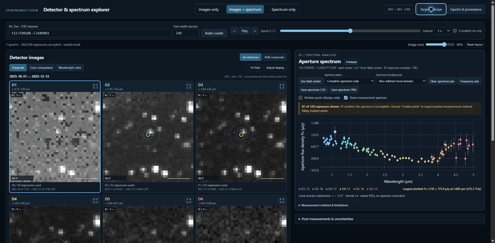
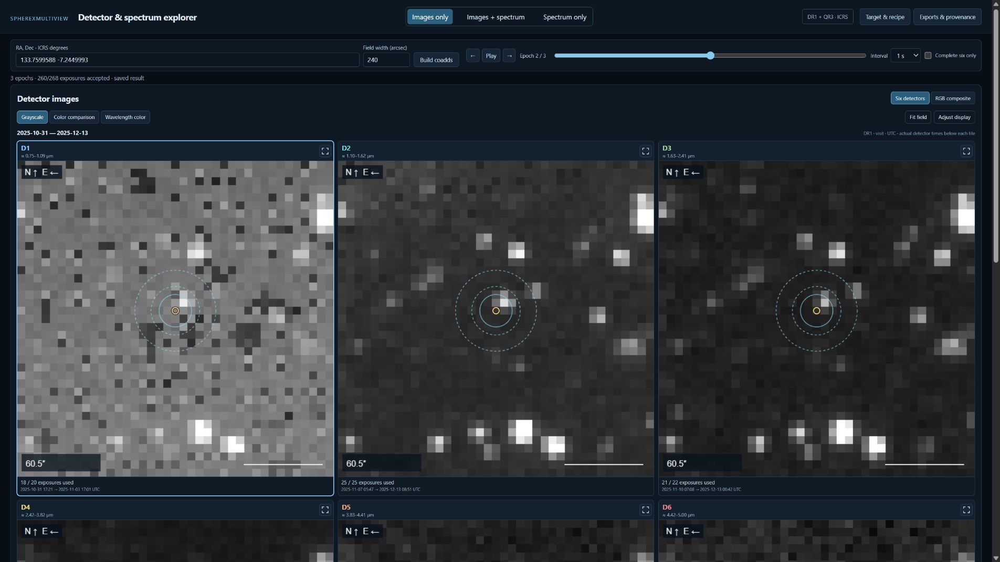
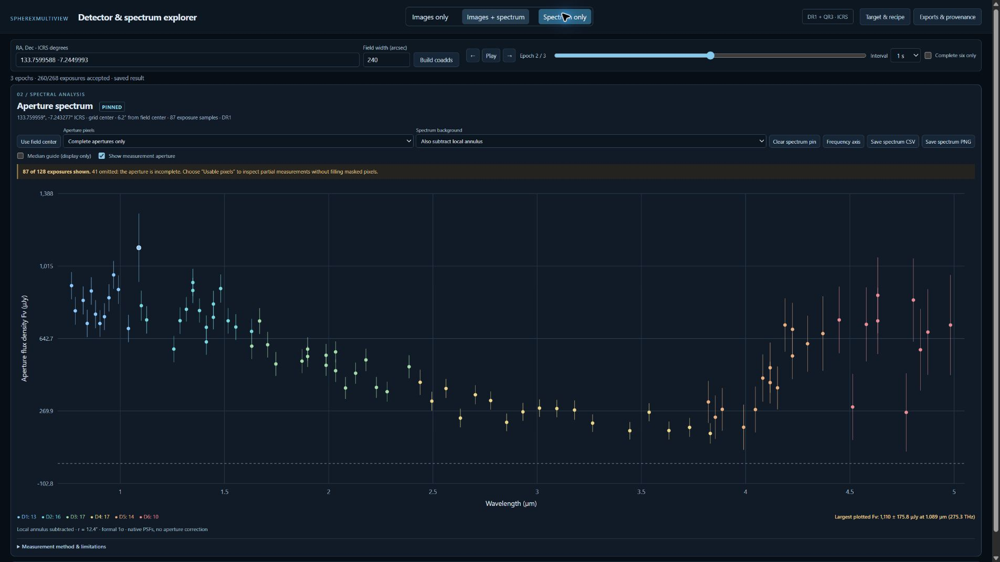
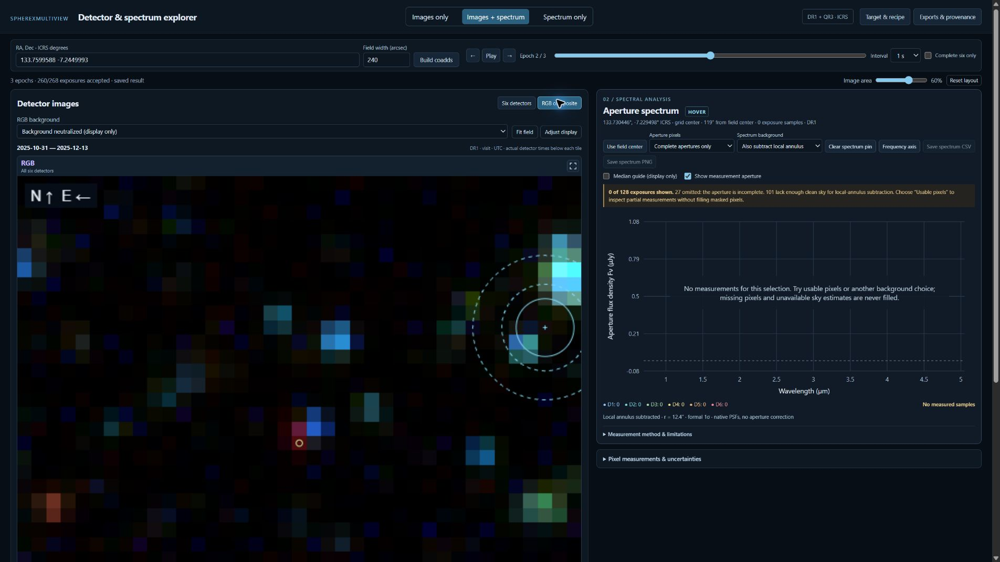
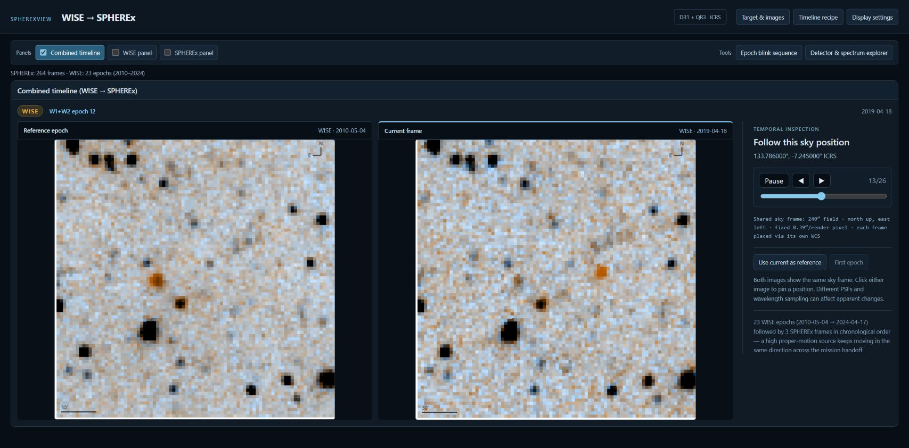

# Final research workspace UI review

Verified the installed DR1 production build with the saved field at ICRS
133.7599588°, −7.2449993°, 240 arcsec, epoch 2. This report supersedes the
earlier height-constrained layout checks, which missed unreadably small tiles.

## Acceptance results

- Coordinates, field width and playback share one sticky command bar.
  At the normal 1707×842 viewport, the image/spectrum workspace begins at
  y=171 CSS pixels. Status and layout balance share one row.
- Split view defaults to 60% image width and permits 40–70%. Reset restores
  60%. Images-only fills the available workspace: at 1920×1080 the panel is
  1864.7 pixels wide and individual detector images are about 606 pixels square.
- Both image views have identical outer panel dimensions at every tested
  viewport. All seven canvases stay mounted; the inactive view is inert and
  hidden from accessibility navigation. Selection and measured samples persist.
- Six-detector images are approximately 245 pixels square at 1366×768,
  312 at 1707×842, and 355 at 1920×1080 in the default split.
- Spectrum-only fills the workspace. The image-area control and reset affect
  layout only. Fit field restores image zoom/pan without rebuilding data.
- Settings lock the underlying page, Escape closes the dialog and restores
  focus to its opener. No nested vertical scroll containers remain in the
  closed-settings workspace. No horizontal page overflow was measured.
- The loaded WISE timeline was visually reviewed with fixed reference/current
  images, nearby playback and settings controls. Its duplicate spectrum action
  is removed; the detector explorer is the primary route.

## Responsive evidence

[geometry.json](geometry.json) records both image views at 360×800, 390×844,
1024×768, 1366×768, 1920×1080 and 2560×1440. Images remained square and panel
dimensions were identical across each RGB/six-detector pair.

Below 900 pixels, image and spectrum panels stack. Three detector columns are
retained; expand a tile for detailed inspection. Large square images, the
stable shared panel height, short screens and expanded details can require
ordinary vertical scrolling. The design does not shrink images merely to
force all content into one screen. These are Chrome viewport checks, not
exhaustive tests of every browser, device or accessibility configuration.

## Automated validation

- DR1 frontend: 63 tests passed; older checkout frontend: 53 passed.
- DR1 backend: 135 tests passed, with two dependency deprecation warnings.
- Both frontend production builds passed.
- DOM regressions cover all focus modes, URL persistence, unchanged pins and
  spectrum markup, retained canvases, balance/reset and no rebuild requests.
- Real saved scientific arrays, spectrum CSV and result bytes remain identical
  through RGB neutralization; see [the invariance report](../rgb-background-2026-11-17/display-invariance.json).

## Screenshots

