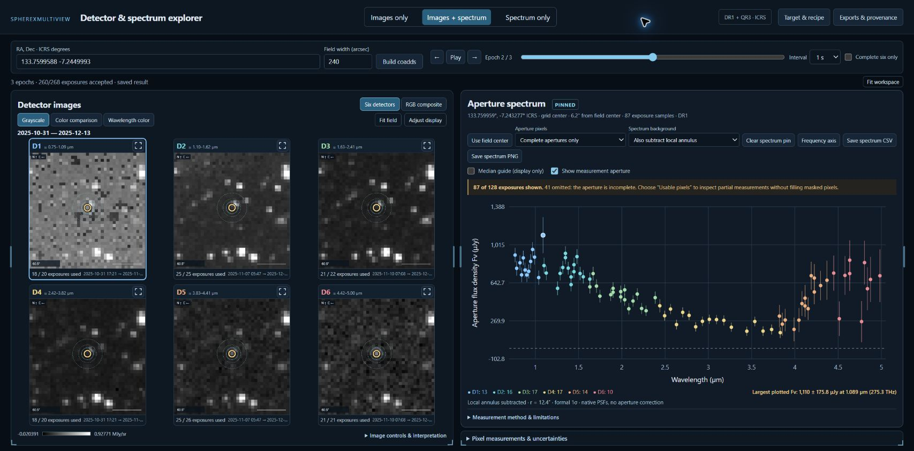
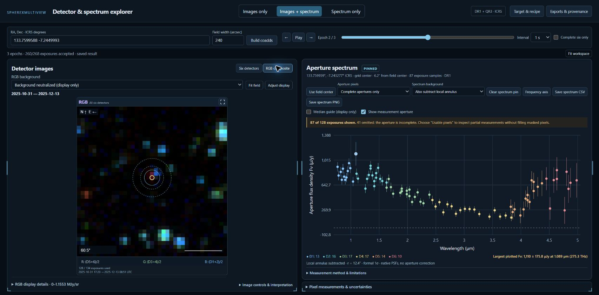

# Panel resizing and viewport fit — 17 November 2026

This review supersedes the sizing claims in the earlier `ui-final-2026-11-17` report. Those checks established square images and horizontal fit but missed the full image extending below the viewport.

The revised acceptance condition checks the complete image, all six images in detector mode, the spectrum plot, and panel bounds against both viewport dimensions. It also checks native mouse dragging rather than relying only on DOM events.

## Changes

- Removed the Image area slider. Panel sides resize the docked split; lower edges/corners adjust height, with width also adjustable from corners. Pointer capture handles leaving a handle; cancellation ends the drag. Arrow keys adjust the focused handle, Home or double-click resets, and Fit workspace restores equal widths and fitted heights.
- Image squares use the smaller of available width and height after accounting for labels, controls and legends. RGB and six-detector modes keep the same panel bounds. Six tiles remain in three columns and two rows.
- Compact tile metadata and color legends preserve image space. Full timestamps remain available on hover. No science arrays or photometry calculations are changed.
- Expanded detector inspection places image and spectrum beside one another on desktop, rather than stacking them into a scrolling modal.

## Verification

- Installed DR1 production build, saved result for 133.7599588, -7.2449993, 240 arcsec, epoch 2.
- [Desktop geometry](desktop-geometry.json): 1280×720, 1366×768, 1536×864, 1920×1080 and 2560×1440; both RGB and six-detector modes. Complete images and plot fit; no default page scrolling. Six grayscale image sides: 155, 179, 227, 295 and 402 CSS pixels, respectively.
- Normal 1707×842 desktop screenshots below show the complete workspace. Both panel bounds remain identical when switching image modes.
- Native Chrome mouse: dragged the divider, then the image panel's lower-right corner. Width and height changed, square images refitted, and Fit workspace restored the default.
- Focus modes, grayscale/color/wavelength modes and RGB reviewed. Color and wavelength mode tiles fit at 1366×768 (150 and 145 pixels square).
- Expanded D1 modal: client/scroll heights both 768 at 1366×768, and both 720 at 1280×720; full plot and image visible.
- Narrow 390×844 screen: stacked document flow, no horizontal overflow. Vertical scrolling is intentional at this size. Desktop resize handles are hidden below 901 pixels. Expanded explanations/settings may require scrolling; they are not part of the default closed-detail fit condition.
- DR1 frontend 63/63 tests and older checkout 53/53 tests pass; both production builds pass. DOM regression checks removal of the slider, pointer resize/cancellation, keyboard/reset, unchanged spectrum markup and no rebuild request. Previously verified backend tests were not rerun because extraction code is unchanged.
- Browser evidence is Chrome on Windows, not certification of every browser or screen size.

